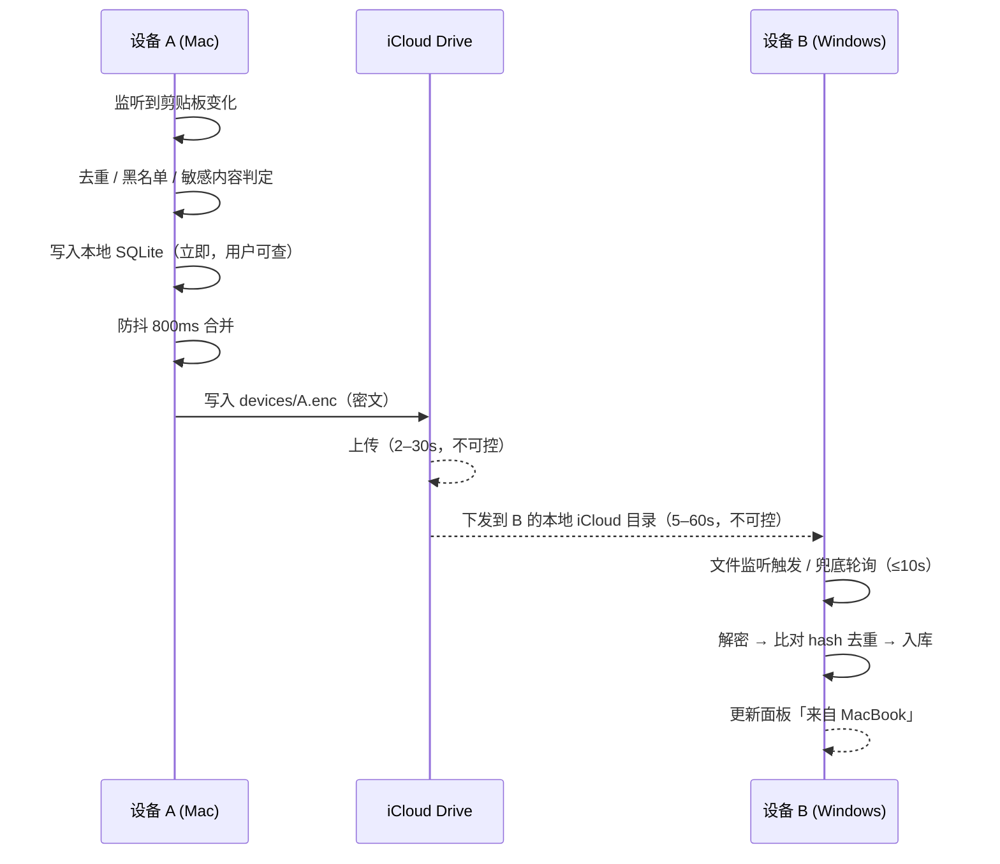

# JCopy 需求规格说明

> 跨平台轻量剪贴板共享工具 · 需求分析与产品定义
> 版本：v0.1（需求基线，待确认）
> 更新：2026-10-29

---

## 0. 一页纸摘要

| 项 | 结论 |
|---|---|
| 一句话定位 | 一个键盘驱动、常驻后台的剪贴板面板，让 Mac 与 Windows 之间的复制粘贴像在同一台机器上一样 |
| 对标 | macOS iCopy（功能拆解后做减法，界面上做加法） |
| 平台 | macOS（一等公民）、Windows（一等公民）、Linux（X11 尽力兼容，Wayland 不承诺） |
| 技术选型 | Tauri 2 + Rust 平台壳 + TypeScript 核心逻辑 + React 界面 |
| 同步通道 | iCloud Drive 作为唯一中继（不做服务端、不做账号） |
| 快路径 | 同网段时用局域网直连加速，失败静默降级到 iCloud |
| 自动粘贴 | 默认关闭（不申请系统辅助功能权限即可完整使用） |
| MVP | 文本剪贴板 + 历史 + 搜索面板 + 纯文本粘贴 + 应用黑名单 + 双端同步 |
| 明确不做 | OCR、快捷回复语料库、文件剪贴板、团队共享、账号体系 |

---

## 1. 产品定位

### 1.1 解决什么问题

现有工具都只解决了一半：

| 方案 | 缺的那一半 |
|---|---|
| iCopy / Paste / Maccy | 只覆盖 macOS。Windows 上是另一个世界 |
| Windows 自带剪贴板历史（Win+V） | 只在本机、无搜索、上限 25 条、无法跨设备 |
| 各类「云剪贴板」网站 | 手动上传下载，破坏复制粘贴的肌肉记忆 |
| 跨平台同步类工具（如 KDE Connect） | 需要手机端常驻，桌面到桌面体验粗糙 |

真正的空白是：**同一个人有两台桌面机器（Mac + Windows），希望"复制完切过去直接粘贴"这一个动作成立。** 且不希望为此注册账号、上传明文、装一个 100MB 的运行时。

### 1.2 价值主张（按重要性排序）

1. **零配置跨端**：装好、配对一次，之后复制即同步，不需要"点发送"。
2. **键盘闭环**：`⌘⇧V` → 输入 → `↵` → 内容已落在光标处。全程不碰鼠标。
3. **轻**：安装包小于 15MB，常驻内存小于 100MB，空闲 CPU 接近 0。
4. **不联网也能用**：没有账号、没有服务器，本机历史完全离线可用；同步只借道用户自己的 iCloud。

### 1.3 非目标（明确不做，避免范围蔓延）

- 不是团队协作工具：不做共享剪贴板、不做多人可见、不做审计。
- 不是密码管理器：不承诺保管敏感信息，反而要主动避开它们。
- 不是快捷回复/话术工具：iCopy 那套面向客服的图文模板不在范围内。
- 不做移动端：iOS 后台剪贴板访问受限，投入产出比不成立。

---

## 2. iCopy 功能拆解与取舍

### 2.1 事实校正

先纠正三处常见误解，它们直接影响裁剪判断：

| 常见说法 | 实际情况 |
|---|---|
| iCopy 支持 OCR | **不支持**。其官方能力列表中无 OCR。截图取字属于系统能力（macOS 实况文本、Windows 截图工具） |
| iCopy 有「规则过滤」 | 实为**按应用的黑名单**（剪贴板监听黑名单、快捷键黑名单），不是正则规则引擎 |
| iCopy 有「合并复制」 | 真实形态是**剪贴板堆栈**：多条加入堆栈后合并为一条 |
| iCopy 有「云同步」 | 实为 **iCloud 备份/同步**，只覆盖 Apple 生态，Windows 无解 |

最后一条正是 JCopy 存在的理由。前三处误解如果照单做成功能，会白做三块工作量。

### 2.2 全量拆解

| 能力 | iCopy 的形态 | 使用频次 | JCopy 判定 |
|---|---|---|---|
| 剪贴板监听 | 常驻记录文本/图片/文件，按类型分类 | 极高 | **必做**（仅文本） |
| 历史记录 | 无限条，可限制磁盘占用 | 极高 | **必做**（带上限） |
| 快捷键呼出面板 | `⇧⌘V` 唤起，横/竖两种面板，可跟随光标 | 极高 | **必做** |
| 搜索 | 对历史全文搜索 | 高 | **必做** |
| 双击 / 回车写回 | 先写剪贴板，用户自行粘贴 | 极高 | **必做** |
| 自动粘贴到前台应用 | 模拟按键 | 高 | **必做但默认关** |
| 纯文本粘贴 | 剥离富文本格式 | 高 | **必做** |
| 应用黑名单 | 密码类 App 不记录、快捷键不冲突 | 中高 | **必做**（隐私底线） |
| 收藏 | 固定常用条目 | 中 | **P1** |
| 分组管理 | 悬浮切换分组 | 中 | **P2** |
| 剪贴板堆栈（合并复制） | 多条合并为一条 | 中低 | **P1** |
| 快捷回复（图文模板 + 数字秒发） | 客服/销售语料库 | 窄人群 | **不做** |
| 图片历史与预览 | 记录图片、文件预览 | 中 | **P1（图片）/ 不做（文件）** |
| iCloud 同步 | macOS ↔ iOS | 中 | **重构为核心能力**（跨平台） |
| 导入 / 导出 | 数据包备份 | 低 | **P1** |
| 主题 / 音效 | 外观定制 | 低 | **不做** |

### 2.3 三条裁剪原则

1. **凡是「改变剪贴板语义」的都不做**（文件剪贴板、富文本跨端还原）。跨平台时这些语义没有公共子集，硬做会做成四不像。
2. **凡是「属于另一个产品」的都不做**（快捷回复、团队共享）。它们和剪贴板共用面板，但数据模型、使用场景、商业模式都不同。
3. **凡是「系统已经做好」的都不做**（OCR）。重复造轮子的收益是负的。

---

## 3. 需求边界

### 3.1 同步范围

| 维度 | 决定 |
|---|---|
| 核心目标 | **同一账号（准确说是同一配对组）的多设备同步**，且优先保证局域网场景的低延迟 |
| 账号体系 | **无账号**。身份 = 设备配对关系。不注册、不登录、服务端不掌握任何用户标识 |
| 服务端 | **无自建服务端**。iCloud Drive 充当传输介质（用户自己的存储配额） |
| 同步内容 | 纯文本（P0）、图片（P1）。不含文件 |
| 同步方向 | 双向，每条记录携带来源设备，避免回环 |
| 删除传播 | **不传播**。A 机删除不影响 B 机（与 JShell 的同步哲学一致：这是"搬运"不是"镜像"） |
| 历史条数同步 | 每设备只同步最近 200 条 + 全部固定项，不做全量历史镜像 |

### 3.2 用户规模与使用假设

- 单用户 1–3 台桌面设备（典型：一台 Mac + 一台 Windows，或 MacBook + 台式）。
- 不假设用户会读文档：所有配置必须能在界面上完成。
- 不假设网络可控：公司网络可能禁 mDNS、可能隔离客户端，iCloud 通道必须能在这种情况下独立工作。

### 3.3 延迟要求

| 场景 | 目标 | 可接受上限 |
|---|---|---|
| 局域网（同网段） | < 300ms | 800ms |
| 跨网（iCloud 中继，mac ↔ mac） | < 5s | 30s |
| 跨网（iCloud 中继，mac ↔ win） | < 15s | 90s |
| 本机面板唤起到可交互 | < 120ms | 250ms |
| 本地搜索（1000 条） | < 30ms | 80ms |

跨网延迟主要由 iCloud 客户端决定，**不受 JCopy 控制**。这是选择 iCloud 中继必须接受的代价，也是保留局域网快路径的原因。

### 3.4 隐私与敏感内容

剪贴板是密码、验证码、私钥、客户资料泄漏风险最高的数据源。硬性要求：

| 要求 | 说明 |
|---|---|
| 来源黑名单 | 用户可在设置里指定"这些应用的复制不记录"（按 bundle id / 进程名）。内置建议名单（1Password、Bitwarden、Keychain 访问、KeePassXC 等）但默认不启用，首次启动时提示勾选 |
| 敏感内容启发式 | 命中"疑似密码/私钥/银行卡"模式的条目**仅存本机，不进入同步文件**（可关闭） |
| 同步内容加密 | iCloud 目录中的文件**一律为密文**，密钥只在配对设备之间共享，不经过任何服务器 |
| 暂停监听 | 全局快捷键一键暂停，托盘图标变为静音态 |
| 一键清空 | 清空本机历史；可选同时清空自己在 iCloud 中的同步文件 |
| 本机存储 | SQLite；是否加密存储作为 P1 选项（默认关闭，依赖系统全盘加密） |

---

## 4. 用户场景与核心流程

### 场景 A：本机历史回溯（占比最高）

> 刚复制的一段文案被新内容覆盖了，想找回来。

`⌘⇧V` → 面板从屏幕底部升起 → 列表已显示历史 → 直接 `↑↓` 或输入关键词 → `↵` → 内容粘贴到刚才的输入框。

**关键要求**：粘贴后焦点必须回到原应用、光标位置不变。这决定了实现必须"隐藏窗口"而非"销毁窗口"。

### 场景 B：跨端搬运（产品核心场景）

> 在 Mac 上查到一个地址，想在 Windows 的表格里填。

Mac 上 `⌘C` → 切到 Windows → 光标点进单元格 → `⌘⇧V` → 面板第一项就是刚复制的地址，带 "来自 MacBook" 标记 → `↵`。

**关键要求**：`⌘C` 之后 300ms 内（局域网）或 5s 内（跨网）对端可见。用户不应该需要"手动点发送"。

### 场景 C：跨端定向发送（可选，P1）

> 剪贴板不想全量同步（隐私顾虑），只想把某一条发到另一台。

选中条目 → `⌘⇧↵` → 弹出设备列表 → 选择目标设备 → 对端收到系统通知"来自 MacBook 的文本已就绪"。

### 场景 D：首次配对

> 新装 Windows 版，想让它在 5 分钟内和 Mac 连上。

Windows 端启动 → 提示"用另一台设备生成配对码" → Mac 端「添加设备」→ 显示 6 位配对码（10 分钟有效）→ Windows 端输入 → 双方提示"已连接" → Mac 端立刻复制一段文字验证，Windows 端弹出通知。

**关键要求**：全流程不需要在两台机器间复制粘贴配置、不需要手动找 IP。

---

## 5. 功能需求清单

优先级：**P0 = MVP 必须有**，**P1 = 第二个版本**，**P2 = 明确不做**。

### 5.1 剪贴板采集（FR-C）

| 编号 | 需求 | 优先级 | 验收标准 |
|---|---|---|---|
| FR-C-01 | 监听系统剪贴板文本变化 | P0 | 任一应用复制文本后 200ms 内入库 |
| FR-C-02 | 相同内容去重 | P0 | 连续复制同一内容不产生新记录，仅更新 `last_used_at` |
| FR-C-03 | 记录来源应用 | P0 | 每条记录带上来源应用标识，用于展示图标与黑名单判断 |
| FR-C-04 | 来源黑名单 | P0 | 命中黑名单的应用，其复制内容不入库、不出现在面板 |
| FR-C-05 | 暂停 / 恢复监听 | P0 | 快捷键或托盘切换，状态在图标上可见 |
| FR-C-06 | 应用内复制不自我触发 | P0 | JCopy 自己写回剪贴板的动作不产生新记录（防回环） |
| FR-C-07 | 超长文本处理 | P0 | 超过 64KB 的文本入库但**不参与同步**，面板中标注"仅本机" |
| FR-C-08 | 图片采集 | P1 | 记录 PNG 数据与缩略图，可预览与粘贴 |
| FR-C-09 | 富文本 / HTML 采集 | P2 | 不做，统一按纯文本处理 |

### 5.2 历史与存储（FR-H）

| 编号 | 需求 | 优先级 | 验收标准 |
|---|---|---|---|
| FR-H-01 | 本地持久化 | P0 | 重启应用历史不丢 |
| FR-H-02 | 条数上限 | P0 | 默认 1000 条，可配置 100–10000，超限按「最久未使用」淘汰 |
| FR-H-03 | 体积上限 | P0 | 默认 200MB，超限时优先淘汰未固定的图片 |
| FR-H-04 | 固定 / 取消固定 | P1 | 固定项不参与淘汰，永远排在最前 |
| FR-H-05 | 手动删除单条 | P0 | 面板中 `⌘⌫` 删除，不影响其他设备 |
| FR-H-06 | 清空全部 | P0 | 二次确认，可选择是否同时清除云端口 |
| FR-H-07 | 导入 / 导出 | P1 | 导出为加密数据包，可指定保存位置 |
| FR-H-08 | 本地加密存储 | P1 | 可选，开启后需要口令解锁 |

### 5.3 面板与检索（FR-P）

| 编号 | 需求 | 优先级 | 验收标准 |
|---|---|---|---|
| FR-P-01 | 全局快捷键唤起 | P0 | 默认 `⌘⇧V` / `Ctrl+Shift+V`，可自定义，冲突时明确提示 |
| FR-P-02 | 唤起即聚焦搜索框 | P0 | 无鼠标操作即可输入 |
| FR-P-03 | 实时过滤 | P0 | 输入即筛选，1000 条下响应 < 30ms |
| FR-P-04 | 键盘导航 | P0 | `↑↓` 移动、`↵` 粘贴、`Esc` 关闭，全部可用 |
| FR-P-05 | 写回剪贴板并粘贴到前台应用 | P0 | 焦点回到原应用，内容落在原光标处 |
| FR-P-06 | 纯文本粘贴 | P0 | `⌥↵` 剥离格式后粘贴 |
| FR-P-07 | 自动粘贴开关 | P0 | 默认关闭。关闭时仅写回剪贴板，用户自行 `⌘V` |
| FR-P-08 | 数字快选 | P1 | `⌘1`–`⌘9` 直接粘贴前 9 条 |
| FR-P-09 | 类型筛选 | P1 | 顶部 chip：全部 / 文本 / 图片 / 已固定 |
| FR-P-10 | 模糊搜索 + 拼音首字母 | P1 | 输入 `wx` 可命中"微信" |
| FR-P-11 | 时间轴分组 | P1 | 刚刚 / 今天 / 昨天 / 更早 |
| FR-P-12 | 多条合并复制 | P1 | 多选后合并为一条（对应 iCopy 的堆栈） |
| FR-P-13 | 分组管理 | P2 | 不做 |

### 5.4 同步（FR-S）

| 编号 | 需求 | 优先级 | 验收标准 |
|---|---|---|---|
| FR-S-01 | iCloud 目录中继 | P0 | 两台设备装同一个 iCloud 账号客户端，即可同步 |
| FR-S-02 | 设备配对 | P0 | 6 位配对码，10 分钟有效，全程无需手动复制配置 |
| FR-S-03 | 端到端加密 | P0 | 云端的同步文件为密文，任何设备以外的程序无法解读 |
| FR-S-04 | 双向增量同步 | P0 | 只在内容变化时写文件，空闲时不产生写入 |
| FR-S-05 | 回环抑制 | P0 | 收到自己发出的内容不重复入库、不再转发 |
| FR-S-06 | 局域网直连加速 | P0 | 同网段自动启用，延迟 < 300ms，失败静默降级 |
| FR-S-07 | 冲突处理 | P0 | 每设备独立文件，天然无写冲突；同内容按 hash 去重 |
| FR-S-08 | 设备管理 | P0 | 可查看已配对设备、查看最后同步时间、移除设备 |
| FR-S-09 | 同步状态可见 | P0 | 面板底部显示"已同步 / 同步中 / 上次同步 2 分钟前 / 未启用" |
| FR-S-10 | 定向发送 | P1 | 选中条目只发往指定设备 |
| FR-S-11 | 手动立即同步 | P1 | 应对 iCloud 延迟异常时的应急按钮 |
| FR-S-12 | 自建服务器 / 账号体系 | P2 | 不做 |

### 5.5 系统集成（FR-SYS）

| 编号 | 需求 | 优先级 | 验收标准 |
|---|---|---|---|
| FR-SYS-01 | 托盘 / 菜单栏常驻 | P0 | 左键打开面板，右键菜单（暂停、设置、清空、退出） |
| FR-SYS-02 | 开机自启 | P0 | 默认开启，可在设置关闭 |
| FR-SYS-03 | 单实例 | P0 | 重复启动时唤起已有实例 |
| FR-SYS-04 | 浅色 / 深色跟随系统 | P0 | 无闪烁切换 |
| FR-SYS-05 | 权限引导 | P0 | 需要辅助功能权限时，给出可点击跳转的说明页，而非只报错 |
| FR-SYS-06 | 更新检查 | P1 | 启动时静默检查新版本，手动触发下载 |
| FR-SYS-07 | 多语言 | P1 | 中文 / 英文 |

---

## 6. 同步机制设计（本方案的核心）

### 6.1 为什么 iCloud 能当中继

iCloud Drive 对应用来说就是一个**普通目录**：macOS 上是 `~/Library/Mobile Documents/com~apple~CloudDocs/`，Windows 上是 iCloud for Windows 客户端映射的本地目录。写入即上传，读取时按需下载。

所以它本质是一个**最终一致的共享文件夹**，可以当"信箱"用。关键设计是：**不要把它当数据库用，要当邮筒用。**

### 6.2 目录布局

```
iCloud Drive/JCopy/
├── manifest.json                  # 协议版本、格式版本（明文，不含任何内容）
├── devices/
│   ├── <deviceId-A>.enc           # A 机的发件箱：最近 200 条 + 全部固定项
│   └── <deviceId-B>.enc           # B 机的发件箱
└── pair/
    └── <inviteId>.invite          # 配对邀请（含用配对码加密的会话密钥，10 分钟后自动清理）
```

**每台设备只写自己的文件，只读别人的文件。** 这一条设计直接消灭了"两台设备互相覆盖"这一类问题——这正是 JShell 自动同步踩过的坑（两台机器都认为自己是权威，谁后写谁赢）。

### 6.3 发件箱文件结构（加密前）

```json
{
  "v": 1,
  "device": { "id": "a1b2...", "name": "MacBook Pro", "platform": "macos" },
  "updatedAt": 1761724800,
  "clips": [
    {
      "id": "clp_01J...",
      "kind": "text",
      "text": "https://example.com/...",
      "hash": "sha256:9f2c...",
      "sourceApp": "com.apple.Safari",
      "createdAt": 1761724795,
      "pinned": false
    }
  ]
}
```

- 加密：AES-256-GCM，密钥由主密钥 + deviceId 通过 HKDF 派生。
- 写入策略：变更后防抖 800ms 合并为一次写，避免频繁触发 iCloud 上传节流。
- 大小：200 条 × 平均 500 字节 ≈ 100KB，加密后约 110KB。可接受。
- 只在密文变化时写盘（比对上次写入的密文 hash），空闲时零写入。

### 6.4 配对协议

不依赖局域网，因为两台设备可能根本不在同一个网络。

```
Mac 端「添加设备」
  ├─ 生成 32 字节主密钥 K
  ├─ 生成 6 位配对码 P（显示给用户）
  ├─ 用 Argon2id(P, salt) 加密 { K, macDeviceId } → pair/<inviteId>.invite
  └─ 写入 iCloud/pair/（10 分钟后由写入方清理）

Windows 端「输入配对码」
  ├─ 扫描 iCloud/pair/ 下的 .invite（只读，不删除）
  ├─ 用用户输入的 P 逐个尝试解密
  ├─ 成功 → 得到 K → 写入自己的 devices/<deviceId>.enc
  └─ 提示「已连接到 MacBook Pro」
```

安全评估：攻击者若能看到 iCloud 目录，可离线爆破 6 位数字（100 万组合）。缓解措施是 Argon2id 高成本参数（约 0.5s/次）+ 邀请文件 10 分钟过期 + 解密失败 5 次后本地锁定。对于"剪贴板历史"这个威胁等级，这个强度是相称的。

### 6.5 同步时序（跨网，经 iCloud）



端到端延迟 = 上传 + 下发 + 轮询，实测中位数预计 5–20 秒（mac 对 mac），10–60 秒（跨到 Windows）。**这就是必须保留局域网快路径的量化理由。**

### 6.6 局域网快路径

| 项 | 设计 |
|---|---|
| 发现 | mDNS 广播 `_jcopy._tcp`，携带 deviceId 与公钥指纹 |
| 鉴权 | 配对时已交换公钥，直连时校验指纹，不匹配直接拒绝 |
| 传输 | WebSocket over TLS 1.3，消息为加密 JSON |
| 降级 | 连接失败 3 次（约 6 秒）后静默停止尝试，仅走 iCloud，30 分钟后重试 |
| 开关 | 默认开，设置中可关闭（部分公司网络会告警 mDNS） |
| 优先级 | 局域网在线时，新条目优先走直连，同时仍异步写入 iCloud（保证离线可追） |

**双写不冲突**：iCloud 写入是"发件箱快照"，直连是"即时消息"。对端按 hash 去重，重复收到同一条不会产生两条记录。

### 6.7 必须接受的三个硬约束

| 约束 | 影响 | 缓解 |
|---|---|---|
| iCloud 是最终一致，不是实时 | 跨网延迟 5–60s，且抖动大 | 局域网快路径覆盖高频场景；面板显示"上次同步 N 分钟前"管理预期 |
| Windows 依赖 iCloud for Windows 客户端 | 用户必须先装并登录；路径与延迟随版本变化 | 首次运行检测目录存在性，缺失时给出图文引导；路径可手动指定 |
| iCloud 对小文件高频写入有节流 | 短时间内大量复制可能延迟上传 | 防抖合并写 + 只在密文变化时写盘 |

---

## 7. 界面与交互规格

### 7.1 设计目标

iCopy 的界面解决的是"能看见历史"，JCopy 要解决的是"**不用看也能拿到想要的**"。所以主界面是**一个可键盘操作的搜索框 + 一列卡片**，而不是一个需要浏览的窗口。

### 7.2 面板结构

```
┌──────────────────────────────────────────────────────┐
│  ⌕ 搜索剪贴板…                    [全部][文本][固定]  │  48px
├──────────────────────────────────────────────────────┤
│  ▍ https://example.com/docs/api                       │
│     Safari · 来自 MacBook · 2 分钟前              ⌘P  │  68px
├──────────────────────────────────────────────────────┤
│    git commit -m "fix: sync loop"                     │
│    终端 · 本机 · 8 分钟前                             │
├──────────────────────────────────────────────────────┤
│  ▍ 张三  138****8888  北京市朝阳区…                    │
│    微信 · 来自 Windows · 今天 14:20                   │
├──────────────────────────────────────────────────────┤
│  已同步 · 2 台设备 · 上次同步 30 秒前           ⚙  ⋯  │  32px
└──────────────────────────────────────────────────────┘
```

- 尺寸：宽 720px，高自适应（最大 60% 屏高），底部居中，距屏幕底边 80px。
- 出现动画：从下方 12px 位移 + 透明度渐入，120ms，`cubic-bezier(0.16, 1, 0.3, 1)`。
- 背板：macOS 用 `vibrancy`（hudWindow），Windows 用 `mica`，不支持时退化为 92% 不透明纯色 + 1px 描边。
- 圆角 14px，卡片圆角 10px，卡片间距 2px。

### 7.3 卡片信息层级

每张卡片三行信息，从主到次：

1. **内容摘要**：单行截断（URL 显示完整路径而非域名优先），最长 2 行。
2. **元信息**：`来源应用 · 来源设备 · 相对时间`。
3. **状态标记**：固定项左侧 3px 强调色竖条；"仅本机"条目右侧显示锁形图标。

**来源设备标记是跨端产品独有的信息**，要给它稳定位置（元信息第二位），让用户一眼分清"这是本机刚复制的"还是"从另一台同步来的"。

### 7.4 键盘映射

| 按键 | 行为 |
|---|---|
| `⌘⇧V` / `Ctrl+Shift+V` | 唤起 / 隐藏面板 |
| 直接输入 | 搜索 |
| `↑` `↓` | 移动选中 |
| `↵` | 粘贴到前台应用（保留格式） |
| `⌥↵` / `Alt+↵` | 纯文本粘贴 |
| `⌘1`–`⌘9` | 直接粘贴第 N 条 |
| `⌘P` | 固定 / 取消固定 |
| `⌘⌫` | 删除该条 |
| `⌘⇧↵` | 发送到指定设备（P1） |
| `Esc` | 关闭，焦点归还原应用 |

### 7.5 空状态与引导

| 状态 | 表现 |
|---|---|
| 无历史 | "复制点什么试试，它会出现在这里" + 一行快捷键提示 |
| 搜索无结果 | "没有匹配「xxx」" + 建议放宽筛选 |
| iCloud 目录未找到 | 黄色条："未检测到 iCloud 云盘，跨设备同步不可用" + 「如何开启」按钮 |
| 无已配对设备 | 底部显示"仅本机" + 「添加设备」入口 |
| 辅助功能权限未授予 | 首次开启自动粘贴时，弹出说明页（含截图）而非系统报错 |

### 7.6 相对 iCopy 的界面增量

| 维度 | iCopy | JCopy |
|---|---|---|
| 信息密度 | 卡片展示内容 + 类型 | 增加**来源设备**与**同步状态** |
| 打开即用 | 需切换横/竖模式 | 单一形态，尺寸自适应 |
| 检索 | 关键字搜索 | 模糊 + 拼音首字母 + 类型 chip |
| 类型感知 | 按类型分类 | **类型专属预览**：URL 显示域名徽标、颜色值显示色块、JSON 显示结构提示、代码显示语言标签 |
| 状态可见 | 无 | 底部常驻一行同步状态，随时知道"跨端是否可用" |
| 动效 | 基础 | 120ms 位移渐入，列表项 hover 提亮，无弹跳 |

---

## 8. 非功能需求

| 类别 | 指标 | 说明 |
|---|---|---|
| 包体 | macOS dmg < 25MB；Windows setup.exe < 15MB | 对标 iCopy 的 5.5MB，量级上同属"轻" |
| 常驻内存 | < 100MB（目标 60–80MB） | 超过 150MB 视为不合格，这是选 Tauri 的核心原因 |
| 空闲 CPU | < 0.3% | 轮询间隔与去抖策略要控制 |
| 面板唤起 | < 120ms 到可交互 | 窗口必须预热（创建后隐藏，不销毁） |
| 首次启动 | < 1.5s 出现托盘图标 | 不阻塞在同步初始化上 |
| 崩溃恢复 | 异常退出后重启，历史完整 | SQLite WAL 模式 |
| 离线可用 | 无网络时全部本机功能正常 | 同步失败不弹窗，只在状态栏提示 |
| 隐私 | 无遥测、无崩溃上报（或明确可选） | 默认不上报任何数据 |
| 兼容性 | macOS 13+；Windows 10 1809+；Linux X11 | Windows 需 WebView2（Win11 内置，Win10 21H2+ 内置） |

---

## 9. 平台差异与风险

| 维度 | macOS | Windows | Linux |
|---|---|---|---|
| 剪贴板监听 | `NSPasteboard.changeCount` 轮询（无事件） | `AddClipboardFormatListener` 有真实事件；或 `GetClipboardSequenceNumber` 轮询 | X11 为 selection 所有权模型，源程序退出内容即失效，需自行接管 |
| 后台常驻 | 菜单栏 App（`LSUIElement`），无 Dock 图标 | 托盘 `Shell_NotifyIcon` + 注册表 `HKCU\...\Run` 自启 | 依赖 libappindicator / StatusNotifier，桌面环境差异大 |
| 模拟粘贴 | `CGEvent` 合成 `⌘V`，需**辅助功能**授权 | `SendInput`，无需授权，但受 **UIPI** 限制 | X11 `XTestFakeKeyEvent`；Wayland 基本不可用 |
| 权限风险 | 首次使用需引导开权限，是主要流失点 | 目标程序以管理员运行时粘贴会失败，需给出可理解提示 | 无统一权限模型 |
| 打包分发 | Developer ID 签名 + 公证，否则 Gatekeeper 拦截 | 未签名触发 SmartScreen；EV 证书成本高 | AppImage（FUSE 依赖）/ deb / rpm / Flatpak（沙盒切断热键与后台剪贴板） |
| 关键不确定性 | 无 Dock 图标 + 全局热键在 Tauri 下的成熟度 | 跨会话（远程桌面、多用户）下的剪贴板监听行为 | **Wayland 全局热键与后台读取** |

**结论**：Linux 定位为"尽力兼容"。只承诺 X11 下功能完整；Wayland 下若只能"手动复制粘贴"，文档中明确写出，不进入验收标准。

---

## 10. 技术选型与架构

### 10.1 选型结论

**Tauri 2 + Rust 平台壳 + TypeScript 核心逻辑 + React 界面。**

| 维度 | Tauri 2 | Electron | 判定 |
|---|---|---|---|
| 包体 | 8–15MB | 90–120MB | Tauri 胜，直接决定"轻量"这个卖点是否成立 |
| 常驻内存 | 60–90MB | 150–250MB | Tauri 胜，常驻工具的关键指标 |
| 系统能力 | Rust 直接调用 `CGEvent` / `SendInput` / `AddClipboardFormatListener`，无需第三方原生模块 | 需 `robotjs`（年久失修）或 `nut.js`（商业授权） | Tauri 胜，且更可控 |
| 渲染一致性 | macOS/Windows 用系统 WebView，Linux WebKitGTK 有差异 | 三平台 Chromium 完全一致 | Electron 胜 |
| 开发速度 | Rust 编译耗时，迭代较慢 | 热更新，迭代快 | Electron 胜 |
| 既有资产复用 | 无法直接复用 JShell 打包流水线 | 可直接复用 | Electron 胜 |

**结论**：产品定位里"轻"是可量化的硬指标（对标 iCopy 的 5.5MB），而开发速度可以通过"核心逻辑放 TS"来弥补。选 Tauri。

**若出现以下情况则退回 Electron**：Rust 侧平台适配（尤其 macOS 无 Dock 图标 + 模拟按键 + 剪贴板监听三件套）在两周内无法跑通原型。

### 10.2 分层结构（借鉴 JShell 的职责划分）

```
┌─────────────────────────────────────────────┐
│  界面层（React + TS）                        │
│  面板 / 设置 / 托盘菜单                       │
├─────────────────────────────────────────────┤
│  核心逻辑层（纯 TS，可单测）                  │
│  去重 · 历史策略 · 搜索 · 同步协议编解码       │
├─────────────────────────────────────────────┤
│  能力接口层（TS 定义的窄接口）                │
│  ClipboardAdapter · PasterAdapter            │
│  TrayAdapter · TransportAdapter              │
├─────────────────────────────────────────────┤
│  平台壳（Rust，按平台条件编译）               │
│  NSPasteboard / Win32 / X11                  │
│  CGEvent / SendInput / XTest                 │
│  mDNS · TLS · 文件监听                        │
├─────────────────────────────────────────────┤
│  存储（SQLite）                              │
└─────────────────────────────────────────────┘
```

**关键原则（直接来自 JShell 的经验）**：

1. **业务逻辑与平台能力彻底分离**。所有平台差异收敛在 4 个窄接口里，核心逻辑可以只靠单测验证，不依赖真机。
2. **纯函数抽出来单独测**。去重判定、历史淘汰策略、同步文件合并、配对码派生——这些应该是无副作用的纯函数，用 `.mjs` 单测覆盖（JShell 已有 33 个测试文件的成熟做法）。
3. **IPC 白名单**。前端不直接触达系统能力，一律经 `invoke` 白名单命令，命令注册集中在一处，便于审计。对应 JShell 的 `shared/api.ts → preload → ipc.ts` 三件套。
4. **同步是"搬运"不是"镜像"**。删除不传播、文件级快照、每设备独立文件——这套哲学在 JShell 上已经验证过，直接沿用可避免重踩。
5. **版本与分发规范沿用 JShell**：单一版本号来源、CHANGELOG 章节与版本同步、打包产物集中在 `release/<版本>/`。

### 10.3 目录草案

```
JCopy/
├── src/                        # 前端（React + TS）
│   ├── shared/                 # 类型定义 + 与后端共享的常量
│   ├── core/                   # 纯逻辑（去重、搜索、同步编解码）
│   ├── components/             # 面板、卡片、设置页
│   └── platform/               # 4 个 Adapter 的 TS 接口与调用封装
├── src-tauri/
│   ├── src/
│   │   ├── commands/           # invoke 命令注册（白名单）
│   │   ├── clipboard/          # 平台剪贴板实现（条件编译）
│   │   ├── paste/              # 模拟按键实现
│   │   ├── transport/          # iCloud 文件 + 局域网直连
│   │   └── store/              # SQLite 访问
│   └── tauri.conf.json
├── tests/                      # 纯函数单测（node --test）
└── docs/
```

---

## 11. MVP 范围与里程碑

### 11.1 MVP 验收定义

"能在自己的两台机器上连续用一周而不想卸载"，即达成 MVP。

必须同时满足：

1. Mac 上复制，Windows 上 `Ctrl+Shift+V` 能看到并粘贴。
2. 1000 条历史下搜索响应无感知延迟。
3. 常驻一天内存不增长、CPU 接近 0。
4. 密码管理器里复制的密码不会出现在面板里。
5. 断网时本机功能完全正常。

### 11.2 里程碑

| 阶段 | 内容 | 出口条件 |
|---|---|---|
| M0 技术验证 | 三平台剪贴板监听 + 模拟粘贴 + 无 Dock 图标常驻 | 三个能力的原生可行性全部打通；任一不通则评估退回 Electron |
| M1 本机闭环 | 采集、存储、面板、搜索、粘贴、黑名单、托盘、自启 | 单机可日常使用，替代 iCopy 的本地部分 |
| M2 同步闭环 | iCloud 中继、配对、加密、去重、状态显示 | 两台真机连续 3 天同步无错乱 |
| M3 快路径 | 局域网直连、降级 | 同网段延迟实测 < 300ms |
| M4 打磨 | 视觉、动效、引导页、设置页、打包签名 | 可分发给他人安装 |

### 11.3 明确排除在 MVP 之外

图片、合并复制、定向发送、导入导出、更新检查、多语言、Linux 打包。

---

## 12. 待确认清单

已由你拍板、不再讨论的：技术选型按最优（Tauri 2）、自动粘贴默认关、iCloud 中继、界面超越 iCopy、项目名 JCopy。

仍需确认：

1. **同步是否默认全自动**：复制即上传 iCloud，还是需要一个"开启同步"的显式开关？前者顺手，后者让用户对"什么内容离开了本机"有掌控感。
2. **敏感内容启发式要不要做**：做则可能误判（把一段含数字的普通文本标记为"仅本机"），不做则密码类内容只能靠应用黑名单挡。
3. **本机历史是否加密存储**：加密后无法跨机迁移备份，忘记口令即永久丢失；不加密则依赖系统全盘加密。
4. **iCloud 配额占用**：100KB/设备可忽略，但如果 P1 加入图片，200 张截图约 300MB，是否需要单独的配额上限提示？
5. **配对码强度**：6 位数字（易用）还是 8 位（更安全但输入成本上升）？
6. **Linux 是否纳入首个正式版本**：纳入则要占一份打包与测试成本，且 Wayland 下体验不完整。
7. **是否需要"仅局域网"模式**：面向对云同步有顾虑的用户，完全不走 iCloud，只做同网段直连。
8. **托盘图标与品牌视觉**：需要一套应用图标（macOS 圆角矩形、Windows 多尺寸 ico），是否由我出初稿？

---

## 附录 A：与 JShell 的关系

| 方面 | 复用方式 |
|---|---|
| 架构模式 | `shared/api.ts` 类型契约 + 白名单 IPC + 纯函数单测，平移为 Tauri 的 `invoke` 命令注册 |
| 同步哲学 | "搬运不是镜像"、删除不传播、每设备独立文件——避免 JShell 踩过的双端互覆盖 |
| 加密方案 | 沿用"共享口令 + AES-GCM + 密钥指纹"的思路，改为"配对时交换主密钥" |
| 工程规范 | 单一版本号来源、CHANGELOG 与版本同步、`release/<版本>/` 产物归集、冒烟测试 |
| 不可复用的 | Electron 打包链路、Electron 特有 API、渲染层实现 |

## 附录 B：待验证项（动手前各花 1 小时实测）

| 平台 | 待验证 |
|---|---|
| macOS | Tauri 下无 Dock 图标菜单栏 App 的实现路径；`CGEvent` 模拟 `⌘V` 在目标应用为全屏/远程桌面时的行为 |
| Windows | iCloud for Windows 当前版本的实际目录路径（`iCloudDrive` 与旧的 `iCloud Drive` 并存）；UIPI 拦截时的可检测信号 |
| Linux | Wayland 下 `wl-clipboard` 后台读取可行性；`xdg-desktop-portal` GlobalShortcuts 在各桌面的支持度 |
| 通用 | iCloud Drive 同账号两机的实测同步延迟分布（需要真实测量，不能凭经验）；mDNS 在公司网络下的成功率 |
